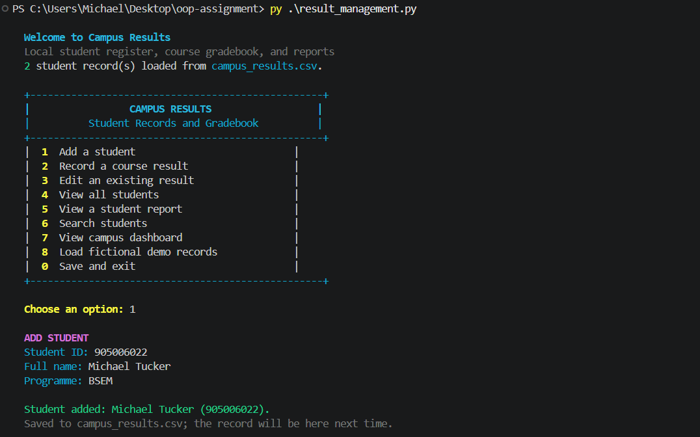
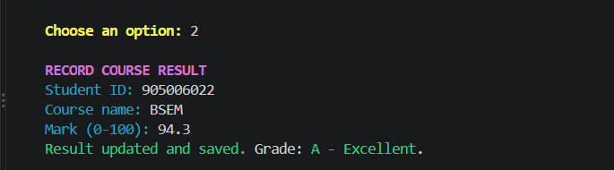
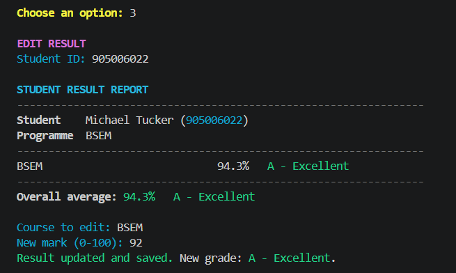
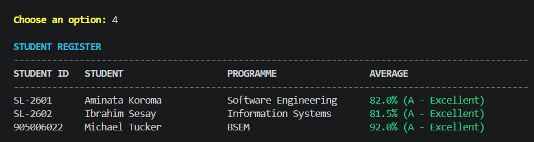
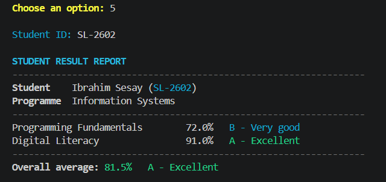
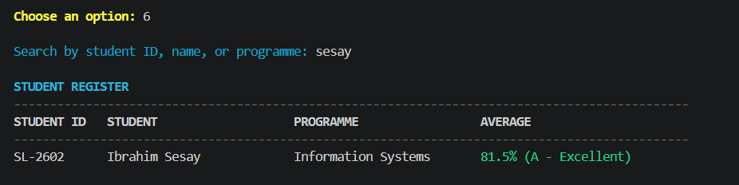
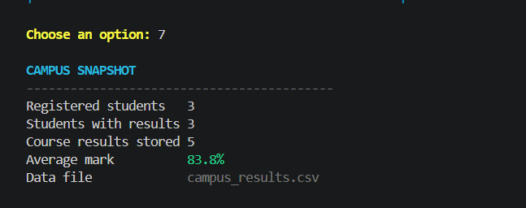
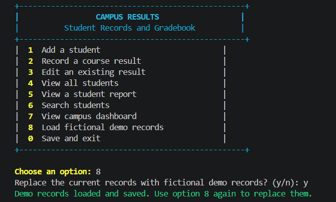
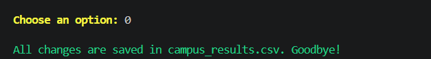

<div align="center">

# CAMPUS RESULTS

### Student Records &amp; Results Management

**Add students · Record and edit marks · Search records · Review reports**

Python | Object-Oriented Programming 1 | PROG211

</div>

---

Campus Results is a colorful, menu-driven academic record prototype created for the PROG211 individual assignment. Student profiles and course marks are saved locally, so changes remain available after the program closes.

> **For learning and demonstration.** Use fictional or authorized information. This is not an official student information system.

## Quick start

**Requirements:** Python 3.10 or newer. No third-party packages are needed.

```bash
python result_management.py
```

On Windows, `py result_management.py` also works. The program creates `campus_results.csv` beside the source file when records are saved. This local CSV is excluded from Git by `.gitignore`.

## Color palette

| Display color | Meaning |
| --- | --- |
| Cyan | App title, section headings, and prompts |
| Green | Saved changes and strong results |
| Blue | Good results |
| Yellow | Menu choices, reminders, and passing marks |
| Red | Errors and marks below 50 |
| Magenta | Add, record, and edit screens |

Color appears in supported interactive terminals. Output stays readable without color when redirected, when `NO_COLOR` is set, or when the terminal does not support ANSI colors. No color package is required.

## Screenshot walkthrough

These screenshots show the options selected during one complete run. Each caption explains the action shown.

> **Review before public upload:** the screenshots include a student name, student ID, and academic results entered during the demonstration. Replace or redact those details if you do not want them published in a public repository.

### 1 — Add a student

Michael Tucker is registered under ID `905006022` in the `BSEM` programme. The confirmation shows that the new record was saved.



### 2 — Record a course result

Records a mark of 94.3 for the student's BSEM course and displays the resulting grade.



### 3 — Edit an existing result

Shows the existing result, updates the mark from 94.3 to 92, and confirms the change was saved.



### 4 — View all students

Displays the register with student IDs, names, programmes, and averages.



### 5 — View an individual report

Shows Ibrahim Sesay's course marks, grade bands, and overall average.



### 6 — Search students

Searches for `sesay` and displays the matching student record.



### 7 — View the dashboard

Summarizes the number of registered students, students with results, course results, and the overall mark average.



### 8 — Load demo records

The program asks before replacing current records with the fictional demonstration dataset.



### 0 — Save and exit

Confirms the data file was saved before the application closes.



## Features

- Add students with a unique ID, name, and programme.
- Save student and result changes locally and load them on the next launch.
- Record a result or update the existing mark for a course.
- Edit an existing mark from the student's report.
- Search by ID, name, or programme.
- View an individual report, student register, and campus summary.
- Validate required fields and marks from 0 to 100.
- Load fictional demo data after confirming replacement.

The example grade bands are A (80–100), B (70–79.9), C (60–69.9), D (50–59.9), and F (below 50). Change `ResultManagementSystem.grade_for` if your lecturer specifies another scale.

## OOP assignment map

| Requirement | Implementation |
| --- | --- |
| Domain classes with attributes and methods | `Student` and `CourseResult` |
| Object creation and interaction | A student owns course result objects; `ResultManagementSystem` manages them. |
| One collection type | Lists store student and result objects; CSV is the local save format. |
| Instance methods | `add_result`, `update_result`, `average_mark`, and management operations |
| Class method | `ResultManagementSystem.create_demo` prepares a demonstration system. |
| Static method | `ResultManagementSystem.grade_for` maps marks to grade bands. |

## Digital Public Goods principles

- **Open and reusable:** uses only the Python standard library and can be adapted for other courses or grading scales.
- **Accessible:** keyboard-driven text menus, clear prompts, and readable messages; color is an enhancement and carries no information by itself.
- **Privacy aware:** no passwords, birth dates, or contact details are requested. Records are stored locally and are not transmitted. The CSV is plain text; use fictional or authorized data, and keep it out of public Git repositories.
- **Modular:** student profiles, course results, and management behavior are separated into classes.

## Project files

```text
result_management.py   Python application
README.md              Project guide and screenshot walkthrough
.gitignore             Excludes local records and temporary files
screenshots/           Captures for menu options 1–8 and 0
campus_results.csv     Local data file created when the app saves
```